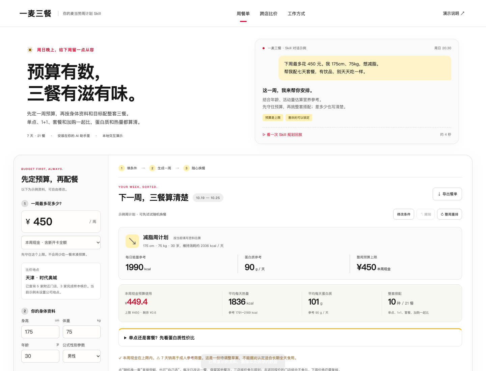
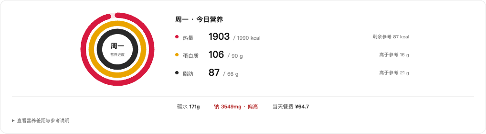

<div align="center">

# 一日三麦

### 预算有数，三餐有滋有味。

周日把下一周排好，想换口味就换一餐。<br />单点、1+1、套餐和加购一起比，营养和账单一起看。

<a href="https://suikv000.github.io/yi-ri-san-mai/"></a>

网页无需安装 · 不用填写 Token · 手机也能打开

[排一周三餐](#先定预算再配餐)　 /　[安装 Skill](#把一日三麦装进对话里)　 /　[MCP 接入](MCP_INTEGRATION.md)

</div>

<a href="https://suikv000.github.io/yi-ri-san-mai/"></a>

<div align="center">

**7天 · 21餐**　 ·　 **单点与套餐一起比**　 ·　 **三层环看当天营养**

</div>

## 先定预算，再配餐

> **你：** 下周最多450元。我175cm、75kg，想减脂。帮我安排七天三餐，别天天吃一样。<br />
> **一日三麦：** 先看身体资料与活动量，再查附近门店。能配多少、花多少钱、营养差多少，都写清楚。

填好条件统一生成。喜欢的餐次锁定，不喜欢的随机换或自己选；每次只改这一餐，其他20餐保留，改完可撤销。适合希望提前安排餐费、比较附近麦当劳买法、关注热量与蛋白质性价比的消费者，也为开发者展示如何将公开菜单组合成实用Skill。

<table><tr>
<td width="33%" valign="top"><h3>① 买法一起比</h3><p>单点、1+1、官方套餐和加购，按相同食物数量比较购买路径。</p><p><sub>不强行凑三件，不把起价当成任意套餐价。</sub></p></td>
<td width="33%" valign="top"><h3>② 附近逐店算</h3><p>门店、规格、渠道和时段都要对上。没取得报价，保留未知。</p><p><sub>天津时代奥城三家门店有独立核价记录。</sub></p></td>
<td width="33%" valign="top"><h3>③ 口味随时换</h3><p>显示换餐费用和营养变化，支持锁定、撤销与保存。</p><p><sub>先守预算，再兼顾营养、距离和重复度。</sub></p></td>
</tr></table>

## 今天吃多少，一眼看明白



日历下方的三层环随日期更新。碳水、钠和当天餐费在下方，详细营养与购买明细可以展开。满环表示达到或超过参考量，**不表示营养全面**。每套同时列出蛋白质/元和蛋白质/100千卡，分清“便宜”和“蛋白质划算”。

## 14.9元，也要看买到什么

官方只读快照中，环湖中道（华夏未来）店的双吉＋小玉米1+1为 **14.9元、482千卡、29g蛋白质**，同店单点双吉23元。最近的宾水西道店当次没有返回可选双吉，不能拿它的13.9元起价算这个组合。

这是2026-10-18的门店快照，不是全国或未来价格承诺。当前有56个本地可购买配餐候选，来自38个有营养对应的购买单元；天津三店共95条单元报价。缺少精确营养的新品不编造数字参与排名。

[查看配餐、蛋白质性价比与天津周边比价分析](docs/一日三麦-配餐与天津周边比价分析-v1.5.md)

## 把一日三麦装进对话里

Skill文件夹可单独安装，让助手按用户资料调用官方MCP再配餐；网页用于体验输出和调整。

<details><summary><strong>安装 Skill · 展开步骤</strong></summary>

Codex首次安装示例，已有同名技能时先比较再更新：

```sh
git clone https://github.com/suikv000/yi-ri-san-mai.git
cd yi-ri-san-mai
mkdir -p ~/.codex/skills
cp -R skills/yi-ri-san-mai ~/.codex/skills/
```

重新加载客户端后试试：

> 使用 $yi-ri-san-mai：周预算450元，175cm、75kg、30岁、男性公式、轻度活动，目标减脂；地点天津时代奥城。查附近门店，比较单点和1+1，安排一周三餐并列出营养差距。

> 使用 $yi-ri-san-mai：只换周三午餐，其余20餐和周预算保留，说明价格与营养变化。

实时查询另需连接官方远程MCP，见 [接入说明](MCP_INTEGRATION.md) 和 [脱敏配置](mcp-config.example.json)。不要在网页输入Token或向Git提交实际凭证。

离线演算历史示例（Node.js18+）：

```sh
node skills/yi-ri-san-mai/scripts/plan.cjs --budget 450 --goal loss
```

输出标为snapshot，默认身体资料是示例；自定义可用 `--settings profile.json`，脚本只读取，不自动保存。

</details>

<details><summary><strong>本地运行、验证和 Pages 构建</strong></summary>

打开 `demo/index.html` 或根目录单文件 `一日三麦-交互演示.html`。也可启动：

```sh
python3 -m http.server 8767 --bind 127.0.0.1 --directory demo
```

访问 `http://127.0.0.1:8767/`；官方食物图片需要网络。

```sh
python3 tools/build_pages.py
node demo/verify.cjs
python3 -m unittest discover -s tests -v
```

构建器只复制六个公开网页文件至 `_site/`，同步Skill计算引擎和快照，并生成单文件。`demo/`为计算代码维护来源；Pages只运行静态演示，不连接个人MCP或执行交易。[验证记录](docs/一日三麦-演示验收-v1.5.md)

</details>

<details><summary><strong>当前范围与数据</strong></summary>

- 已实现预算、身体参数参考、单点/套餐购买路径、营养汇总、三店快照、换餐、锁定、撤销、主动保存和导出。
- 天津时代奥城是用户指定的公开商圈示例，不是住址。距离来自接口，分钟数按80米/分钟换算，尚无公司地点或地图导航。
- 正餐核价10月18日，早餐预约10月19日08:15；未来餐次需复核，复合加购按单元合计，最终整单需再核价。
- 个人卡券及兼容规则未核验，不虚减优惠。卡价/期限为用户假设输入，现金和周分摊分开记账。
- 默认草案仍有钠、脂肪偏高，缺口可见；纤维、饱和脂肪和过敏原缺失不按零。
- 周日自动任务、手机宿主和到点下单尚未接通；无账户读取、领取权益、购卡、订单或支付。
- 身体资料仅在主动保存时写入当前浏览器localStorage，不上传用户档案；导出包含用户填写的资料。

</details>

<details><summary><strong>素材、参考和开源许可</strong></summary>

原创代码、界面与Skill文字采用 [MIT](LICENSE)。官方产品名称、商标、图片及截图内相应内容归权利人，不纳入MIT许可；食物图引用官方接口返回URL。截图展示实际项目界面。

早期展示组织参考 [麦麦热量管家](https://github.com/WilderNoTrack/mcd-calorie-butler)，配餐流程、界面和计算为本项目编写。官方参赛声明保留原文。

</details>

<details><summary><strong>参赛信息</strong></summary>

参加麦当劳程序员创意开发大赛，[参赛声明](CONTEST_DECLARATION.md)为官方原文。使用Codex开发，不申报WorkBuddy专项；报名状态以官方Issue回执为准。同一账号仅Star最高项目进入排行榜，同分按最早报名处理。

</details>

<br /><div align="center">

**把下一周，安排得刚刚好。**

[在线体验](https://suikv000.github.io/yi-ri-san-mai/) · [Skill](skills/yi-ri-san-mai/SKILL.md) · [反馈](https://github.com/suikv000/yi-ri-san-mai/issues)

<sub>独立 Skill 项目 · 非麦当劳官方产品 · 原创代码 MIT 开源</sub>

</div>
